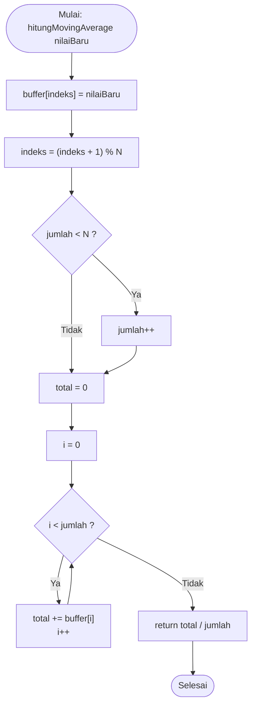

# Pertemuan 5 — Pengolahan dan Analisis Data (Filtering, Analisis, dan Visualisasi)

## Deskripsi Singkat

Praktikum ini membahas tahapan pengolahan dan analisis data pada sistem IoT di dua tempat. Percobaan 5A mengolah data di sisi perangkat (edge processing) pada ESP8266 menggunakan filter moving average serta pencatatan nilai minimum dan maksimum. Percobaan 5B mengolah data di sisi komputer menggunakan Python: data suhu diterima melalui MQTT, disimpan ke file CSV, dianalisis secara statistik, dideteksi anomalinya dengan z-score, lalu divisualisasikan dalam bentuk grafik.

Sesuai keterangan pada tabel data pengamatan modul, seluruh data pada praktikum ini menggunakan **mock function** sebagai pengganti sensor DHT22.

## Alat dan Bahan

- Board ESP8266 DevKit
- Sensor DHT22 *(hanya untuk kode original; pada praktikum tidak digunakan karena data dummy)*
- Breadboard dan kabel jumper
- Kabel USB (Micro-USB/USB-C sesuai board)
- Laptop/PC dengan Arduino IDE (pustaka DHT sensor library, PubSubClient, ArduinoJson) dan Python 3 (pustaka paho-mqtt, pandas, matplotlib)
- Jaringan WiFi yang terhubung ke internet
- Broker MQTT publik `broker.hivemq.com` (port 1883)

## Library / Dependencies

**Arduino IDE (ESP8266):**
- `DHT.h` (DHT sensor library by Adafruit) — hanya untuk kode original 5A.
- `WiFi.h` — pustaka bawaan board manager ESP8266.
- `PubSubClient.h` (by Nick O'Leary) — komunikasi MQTT pada mock publisher 5B.
- `ArduinoJson.h` (by Benoit Blanchon, versi 7) — membuat data JSON.

**Python 3:**
```
pip install paho-mqtt pandas matplotlib
```
- `paho-mqtt` (versi 2.0 ke atas, karena memakai `CallbackAPIVersion.VERSION2`) — subscribe data dari broker MQTT.
- `pandas` — mengelola data tabular (DataFrame) dan menghitung statistik.
- `matplotlib` — membuat grafik.

> **Catatan keamanan:** nilai `ssid` dan `password` pada file `.ino` menggunakan placeholder. Ganti sesuai kredensial WiFi kamu sendiri saat pengujian, dan **jangan commit kredensial WiFi asli** ke repository GitHub publik.

> **Catatan menjalankan:** file `.py` dijalankan lewat terminal (`python nama_file.py`), **bukan** dari Arduino IDE. Simpan file Python di folder biasa, bukan di dalam folder sketch Arduino.

---

## Percobaan 5A: Pengolahan Data Sensor pada ESP8266 (Moving Average dan Statistik)

- Code Percobaan jika pakai DHT22: [`code/percobaan5a_pengolahan_data.ino`](./code/percobaan5a_pengolahan_data.ino)
- Code mock: [`code/percobaan5a_pengolahan_data_mock.ino`](./code/percobaan5a_pengolahan_data_mock.ino)
- Code modifikasi: [`code/percobaan5a_pengolahan_data_modifikasi.ino`](./code/percobaan5a_pengolahan_data_modifikasi.ino)

### Tujuan

Memahami dan mengimplementasikan pengolahan data sensor pada sisi perangkat (edge processing) menggunakan filter moving average serta pencatatan nilai minimum dan maksimum.

### Konfigurasi Pin

| No | Komponen | Pin ESP8266 |
|----|----------|-----------|
| 1 | DHT22 — VCC *(hanya kode original)* | 3.3V |
| 2 | DHT22 — DATA *(hanya kode original)* | GPIO 4 |
| 3 | DHT22 — GND *(hanya kode original)* | GND |

Pada versi mock tidak ada wiring sensor; ESP8266 cukup terhubung ke komputer melalui kabel USB.

### Penjelasan Code

- `const int N = 5` dan `float buffer[N]` — buffer yang menyimpan N pembacaan terakhir untuk moving average.
- `indeks` — posisi penulisan berikutnya pada buffer; `jumlah` — banyaknya sampel yang sudah terisi (agar rata-rata awal tidak dibagi N sebelum buffer penuh).
- `hitungMovingAverage(nilaiBaru)` — menulis nilai baru ke buffer, memajukan `indeks` dengan `(indeks + 1) % N` (buffer melingkar), lalu mengembalikan rata-rata dari data yang terisi.
- `suhuMin` dan `suhuMax` — diinisialisasi dengan nilai ekstrem (1000 dan -1000) lalu diperbarui setiap pembacaan valid.
- `isnan(suhu)` — pembacaan gagal diabaikan agar tidak merusak buffer dan statistik.
- `Serial.print(...)` — menampilkan suhu mentah, hasil filter, minimum, dan maksimum setiap 2 detik.

### Penjelasan Code Mock

- Logika moving average, minimum, dan maksimum **sama persis** dengan code original.
- `bacaSuhuMock()` menggantikan `dht.readTemperature()`: menghasilkan suhu sekitar 28 °C dengan derau acak ±1 °C, kadang lonjakan +4 °C (meniru gangguan/hembusan napas), dan kadang `NAN` (meniru pembacaan gagal).
- `randomSeed(analogRead(0))` — membuat data acak berbeda tiap kali program dijalankan.

### Penjelasan Code Modifikasi (simpangan baku)

- Ditambahkan fungsi `hitungSimpanganBaku(rataRata)` yang menghitung simpangan baku dari data yang terisi pada buffer.
- `selisih = buffer[i] - rataRata` lalu dikuadratkan dan dijumlahkan, kemudian dibagi `(jumlah - 1)` — simpangan baku sampel, sama dengan `.std()` pada pandas.
- `if (jumlah < 2) return 0.0` — simpangan baku sampel butuh minimal 2 data.
- Hasilnya ditampilkan sebagai kolom `Std` pada Serial Monitor.

### Jawaban Pertanyaan Praktikum

**1) Flowchart proses perhitungan moving average pada fungsi `hitungMovingAverage()`**

Alur: fungsi menerima `nilaiBaru` → nilai tersebut ditulis ke posisi `buffer[indeks]` → `indeks` dimajukan dengan `(indeks + 1) % N` agar kembali ke 0 setelah mencapai batas buffer → jika `jumlah < N` (buffer belum penuh) maka `jumlah++`, sehingga pembagi rata-rata hanya sebanyak data yang sudah terisi → `total` diatur ke 0 → perulangan `for` menjumlahkan `buffer[i]` dari `i = 0` sampai `jumlah - 1` → fungsi mengembalikan `total / jumlah` sebagai hasil moving average.



**2) Fungsi operasi `(indeks + 1) % N`**

Operasi ini memajukan `indeks` satu langkah ke posisi berikutnya, lalu operator modulo (`%`) mengembalikannya ke 0 setelah mencapai batas N. Dengan N = 5, `indeks` bergerak 0, 1, 2, 3, 4, lalu kembali ke 0, sehingga buffer bekerja secara melingkar (circular buffer). Akibatnya, data terlama otomatis tertimpa oleh data terbaru sehingga buffer selalu berisi N pembacaan terakhir, dan `indeks` tidak pernah melebihi batas array sehingga tidak terjadi penulisan di luar memori buffer. Program juga tidak perlu menggeser seluruh isi array setiap ada data baru, sehingga lebih hemat komputasi dan memori, yang penting pada mikrokontroler dengan sumber daya terbatas.

**3) Dampak mengubah nilai N menjadi 20 atau 2**

Nilai N menentukan keseimbangan antara kehalusan data dan kecepatan respons filter. Jika N diperbesar menjadi 20, rata-rata dihitung dari lebih banyak data sehingga fluktuasi acak (derau) teredam kuat dan kurva hasil filter sangat halus. Namun respons terhadap perubahan nilai yang sebenarnya menjadi lambat, karena nilai baru hanya berkontribusi 1/20 pada rata-rata. Dengan interval 2 detik, perubahan suhu yang nyata baru tercermin penuh setelah sekitar 40 detik, dan buffer juga memakai memori lebih besar. Sebaliknya, jika N diperkecil menjadi 2, rata-rata hanya dihitung dari dua pembacaan terakhir sehingga respons sangat cepat mengikuti perubahan, tetapi derau dan lonjakan sesaat masih terasa pada hasil filter (kurang halus), sehingga manfaat filternya kecil.

Karena itu pemilihan N perlu disesuaikan dengan kebutuhan: N besar untuk data yang stabil dan banyak derau, N kecil untuk sistem yang harus cepat bereaksi.

**4) Modifikasi program: menghitung simpangan baku dari data pada buffer**

Lihat file: [`code/percobaan5a_pengolahan_data_modifikasi.ino`](./code/percobaan5a_pengolahan_data_modifikasi.ino) 

penjelasan tiap baris tambahan ada di bagian **Penjelasan Code Modifikasi** di atas.

---

## Percobaan 5B: Akuisisi, Analisis, dan Visualisasi Data

- Mock publisher ESP8266: [`code/percobaan5b_mock_publisher.ino`](./code/percobaan5b_mock_publisher.ino)
- Program Python dari Modul: [`code/percobaan5b_analisis_data.py`](./code/percobaan5b_analisis_data.py)
- Program Python dummy: [`code/percobaan5b_analisis_data_dummy.py`](./code/percobaan5b_analisis_data_dummy.py)
- Code modifikasi: [`code/percobaan5b_analisis_data_modifikasi.py`](./code/percobaan5b_analisis_data_modifikasi.py)

### Tujuan

Memahami dan mengimplementasikan pengolahan data pada sisi komputer, mulai dari pengambilan data melalui MQTT, penyimpanan ke file CSV, analisis statistik, deteksi anomali dengan z-score, hingga visualisasi data.

### Alur Data

```
ESP8266 (mock function)  →  broker.hivemq.com  →  Python (paho-mqtt)  →  CSV, z-score, grafik
```

### Parameter Konfigurasi

| No | Parameter | Nilai |
|----|-----------|-------|
| 1 | Broker MQTT | broker.hivemq.com |
| 2 | Port | 1883 |
| 3 | Topic data | unsoed/tk245004/kelompok1/data |
| 4 | Interval publish | 5 detik |
| 5 | Jumlah sampel | 30 data |
| 6 | Batas anomali | \|z\| > 2 |

### Penjelasan Code (Python)

- `on_connect()` — dipanggil saat terhubung ke broker, lalu `client.subscribe(TOPIC)`.
- `on_message()` — dipanggil tiap pesan masuk: `json.loads()` mengurai payload, `float(payload["suhu"])` mengambil nilai suhu, data ditambahkan ke list `data` beserta waktu penerimaan, dan koneksi diputus setelah `JUMLAH_SAMPEL` data terkumpul.
- Blok `try-except` — mengabaikan pesan yang bukan JSON valid atau tidak memuat key `suhu`.
- Tahap 2 — `pd.DataFrame(data).to_csv("data_suhu.csv")` menyimpan data ke CSV.
- Tahap 3 — menghitung rata-rata dan simpangan baku, lalu `zscore = (suhu - rata2) / std`; kolom `anomali` bernilai true jika `|z| > 2`.
- Tahap 4 — `matplotlib` menggambar garis suhu, garis rata-rata, dan titik merah pada data anomali, lalu menyimpannya ke `grafik_suhu.png`.

### Penjelasan Mock Publisher (ESP8266) dan Versi Dummy

- Mock publisher: `bacaSuhuMock()` menggantikan DHT22 (suhu ±28 °C dengan derau dan lonjakan acak); publish setiap 5 detik memakai `millis()` (non-blocking) dalam format `{"suhu": 28.53}`.
- Versi dummy Python: tahap 1 (MQTT) diganti loop yang membangkitkan 30 data suhu acak langsung di Python; tahap 2 sampai 4 sama persis dengan original. Berguna untuk mencoba alur analisis tanpa ESP8266 dan koneksi internet.

### Penjelasan Code Modifikasi (moving average sebelum z-score)

- `pd.read_csv("data_suhu.csv")` — membaca data hasil CSV dari program sebelumnya.
- `df["suhu"].rolling(window=5, min_periods=1).mean()` — moving average jendela 5 data; `min_periods=1` agar 4 data awal tetap dihitung.
- Z-score dihitung dua kali: pada data mentah dan pada data hasil moving average, lalu jumlah anomali keduanya dicetak berdampingan.
- Hasil disimpan ke `data_suhu_ma.csv` dan grafik perbandingan ke `grafik_suhu_ma.png`.
- Pada data dummy yang diuji, moving average cenderung **mengurangi jumlah anomali** (misalnya dari 4 menjadi 0), karena lonjakan sesaat diredam jendela rata-rata. Hasil sebenarnya bergantung pada data.

### Jawaban Pertanyaan Praktikum

**1) Fungsi blok try-except pada `on_message()` dan akibat jika dihilangkan**

Blok try-except menangani pesan yang tidak valid yang mungkin masuk ke topic, karena broker publik dapat menerima pesan dari siapa saja. Contohnya, payload yang bukan JSON valid (misalnya teks `halo`) membuat `json.loads()` gagal dan memunculkan `ValueError`. JSON yang valid tetapi tidak memuat key `suhu` (misalnya `{"temp": 28}`) membuat `payload["suhu"]` memunculkan `KeyError`, dan nilai `suhu` yang bukan angka membuat `float()` memunculkan `ValueError`.

Pada kasus tersebut, blok `except` mencetak `Data tidak valid, diabaikan`, lalu `return`, sehingga data tidak masuk ke list dan program tetap berjalan menunggu pesan berikutnya.

Jika blok try-except dihilangkan, error pada pesan tidak valid tidak ditangani dan program Python berhenti dengan pesan error (traceback). Akibatnya data yang sudah terkumpul belum tersimpan ke CSV, karena tahap 2 sampai 4 berada setelah `client.loop_forever()` dan tidak sempat dijalankan.

**2) Arti z-score dan alasan batas |z| > 2**

Z-score dihitung dengan rumus `z = (x - rata-rata) / simpangan baku` dan menyatakan seberapa jauh suatu nilai menyimpang dari rata-rata dalam satuan simpangan baku. Tanda positif berarti nilai di atas rata-rata, tanda negatif berarti di bawah rata-rata, dan makin besar nilai mutlaknya makin jauh nilai tersebut dari kondisi umum data. Contohnya z = 2,88 berarti data berada 2,88 simpangan baku di atas rata-rata.

Batas |z| > 2 digunakan karena pada data berdistribusi normal sekitar 95% data berada dalam 2 simpangan baku dari rata-rata, sehingga data di luar batas itu hanya sekitar 5% dan dianggap jarang terjadi (tidak wajar). Batas 2 lebih sensitif dibanding batas 3 (yang mencakup sekitar 99,7% data), sehingga cocok sebagai langkah awal pada data yang jumlahnya relatif sedikit seperti 30 sampel. Sebagai ilustrasi, dengan rata-rata 28,27 °C dan simpangan baku 1,46, data dianggap anomali jika berada di luar rentang sekitar 25,35 sampai 31,19 °C.

**3) Kelemahan z-score pada data dengan tren naik atau turun yang tajam**

Z-score mengasumsikan data berkisar stabil di sekitar satu nilai rata-rata. Jika data memiliki tren naik atau turun yang tajam (misalnya suhu naik terus karena sumber panas didekatkan), rata-rata dan simpangan baku dihitung dari seluruh data dengan nilai yang terus bergeser, sehingga nilai di ujung tren yang sebenarnya wajar mengikuti tren bisa terdeteksi sebagai anomali. Di sisi lain, simpangan baku ikut membesar akibat tren sehingga batas |z| > 2 melebar, dan anomali sebenarnya berupa lonjakan sesaat bisa tersamar dan tidak terdeteksi. Metode ini juga sensitif terhadap outlier itu sendiri, karena outlier ikut menaikkan simpangan baku.

Untuk data bertren, metode yang lebih sesuai antara lain z-score pada jendela bergerak (rolling), menghilangkan tren (detrending) terlebih dahulu, atau metode deteksi anomali yang lebih kompleks.

**4) Modifikasi program: moving average jendela 5 data sebelum z-score**

Lihat file: [`code/percobaan5b_analisis_data_modifikasi.py`](./code/percobaan5b_analisis_data_modifikasi.py) 

penjelasan tiap baris tambahan ada di bagian **Penjelasan Code Modifikasi** di atas.

---

## Pertanyaan Analisis

**1) Uraikan hasil tugas pada praktikum yang telah dilakukan pada setiap percobaan!**

Hasil data dummy:

Pada Percobaan 5A, ESP8266 menghitung moving average 5 pembacaan terakhir serta nilai minimum dan maksimum, dan nilai hasil filter lebih halus dibanding data mentah. Pada Percobaan 5B, Python menerima 30 data suhu, menyimpannya ke `data_suhu.csv`, dan menghitung statistik dari data hasil run: rata-rata 28,27 °C, simpangan baku 1,46, minimum 24,41 °C, maksimum 32,48 °C, dengan 4 data terdeteksi anomali dan ditandai pada `grafik_suhu.png`. Angka ini perlu disesuaikan jika program dijalankan ulang.

**2) Bandingkan pengolahan data di sisi perangkat (Percobaan 5A) dengan pengolahan data di sisi komputer (Percobaan 5B) dari segi kecepatan, kompleksitas analisis, dan kebutuhan sumber daya!**

**Kecepatan.** Pada pengolahan di sisi perangkat (5A), data langsung diproses di ESP8266 begitu dibaca, sehingga hasil filter, minimum, dan maksimum tersedia seketika pada setiap pembacaan tanpa menunggu pengiriman data. Pada pengolahan di sisi komputer (5B), data harus dikirim dulu lewat jaringan ke broker, diterima Python, dan dikumpulkan hingga 30 data (sekitar 2,5 menit untuk interval 5 detik) sebelum analisis statistik dan z-score dapat dihitung, sehingga hasilnya tidak langsung tersedia.

**Kompleksitas analisis.** Pengolahan di perangkat dibatasi memori dan daya komputasi ESP8266, sehingga hanya cocok untuk perhitungan sederhana seperti moving average dan nilai minimum/maksimum. Pengolahan di komputer mampu analisis yang lebih kompleks, yaitu statistik deskriptif, z-score untuk deteksi anomali, penyimpanan data historis ke CSV, dan visualisasi grafik dengan pustaka seperti pandas dan matplotlib.

**Kebutuhan sumber daya.** Pengolahan di perangkat tidak membutuhkan komputer maupun koneksi jaringan untuk filter dasar, dan mengurangi jumlah data yang perlu dikirim (hemat bandwidth dan daya), tetapi memakai sebagian memori dan CPU ESP8266. Pengolahan di komputer memanfaatkan sumber daya komputer yang jauh lebih besar, tetapi membutuhkan komputer yang menyala, koneksi internet, broker MQTT, dan ruang penyimpanan untuk data historis.

Dengan demikian kedua pendekatan saling melengkapi: filter ringan di perangkat untuk membersihkan data sejak awal, dan analisis lanjutan di komputer untuk pengambilan keputusan yang lebih mendalam.

**3) Pengaruh ukuran jendela moving average terhadap kualitas data dan kecepatan respons sistem kendali**

**Terhadap kualitas data.** Jendela yang besar meredam derau lebih kuat sehingga data hasil filter lebih halus dan stabil. Jendela yang kecil meredam derau lebih sedikit sehingga data masih berfluktuasi mengikuti pembacaan mentah.

**Terhadap kecepatan respons sistem kendali.** Jika data hasil filter dipakai untuk mengendalikan aktuator berbasis ambang batas (misalnya relay menyala saat suhu melebihi 30 °C), jendela yang besar membuat nilai filter baru melewati ambang batas setelah beberapa pembacaan, sehingga aktuator bereaksi terlambat. Dengan N = 5 dan interval 2 detik, perubahan suhu yang nyata baru tercermin penuh pada nilai filter setelah sekitar 10 detik. Sebaliknya, jendela yang kecil merespons cepat, tetapi lonjakan sesaat akibat derau bisa langsung melewati ambang batas sehingga aktuator mudah menyala-mati secara tidak perlu.

Jadi ukuran jendela harus menyeimbangkan kehalusan data dan kecepatan respons sesuai kebutuhan: aplikasi yang cepat berubah dan kritis membutuhkan jendela kecil, sedangkan aplikasi yang lambat berubah dan sensitif terhadap derau cocok memakai jendela lebih besar. Pendekatan ini juga dapat dikombinasikan dengan histerisis untuk mengurangi aktuator yang berkedip.

**4) Pemanfaatan hasil analisis dan deteksi anomali untuk meningkatkan keandalan sistem IoT**

Hasil analisis dan deteksi anomali meningkatkan keandalan sistem IoT dengan beberapa cara:
- **Menyaring data tidak wajar sebelum dipakai mengambil keputusan.** Pembacaan yang ngawur akibat gangguan sesaat atau sensor error dapat dikenali dan diabaikan, sehingga aktuator tidak bereaksi terhadap data yang salah.
- **Mendeteksi kerusakan sensor.** Anomali yang muncul berulang atau terus-menerus dapat menandakan sensor rusak, kabel longgar, atau perangkat bermasalah, sehingga perawatan dapat dilakukan lebih awal.
- **Memberikan peringatan dini.** Lonjakan atau penurunan mendadak yang memang nyata dapat memicu notifikasi kepada pengguna.

Contoh pada smart farming: pompa penyiraman tidak menyala hanya karena satu pembacaan kelembaban tanah yang ngawur, dan sensor yang terus melaporkan nilai tidak wajar dapat ditandai untuk diperiksa sehingga tanaman tidak kekurangan atau kelebihan air. Contoh pada smart home: lonjakan suhu mendadak (misalnya indikasi kebakaran) dapat memicu peringatan, sedangkan pembacaan tidak wajar yang berulang tidak membuat AC atau kipas menyala dan mati terus, sehingga sistem lebih hemat energi dan lebih tepercaya.

---

## Kesimpulan

1. Pengolahan data pada sistem IoT meliputi akuisisi, pra-pemrosesan (pembersihan dan filter), pengolahan dan analisis, serta visualisasi.
2. Edge processing pada ESP8266 (moving average, minimum, maksimum) mengurangi derau dan beban data sejak di perangkat, tetapi dibatasi kemampuan komputasi perangkat.
3. Filter moving average menghaluskan fluktuasi acak; semakin besar jendela data semakin halus tetapi respons semakin lambat.
4. Pengolahan di sisi komputer dengan Python (paho-mqtt, pandas, matplotlib) memungkinkan penyimpanan data ke CSV, analisis statistik, dan visualisasi yang lebih kompleks.
5. Z-score dengan batas |z| > 2 efektif sebagai langkah awal deteksi anomali, namun kurang cocok untuk data dengan tren tajam.
6. Moving average sebelum z-score dapat meredam lonjakan sesaat sehingga jumlah anomali yang terdeteksi cenderung berkurang.
